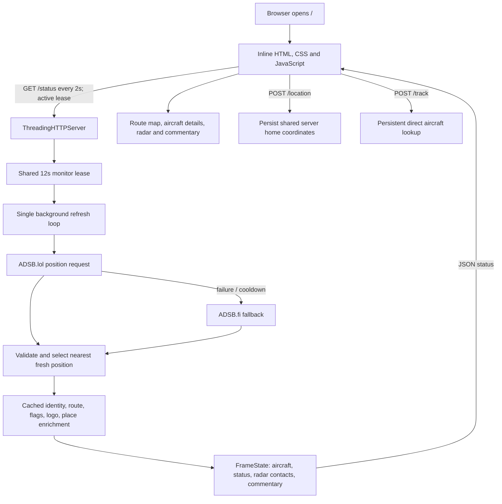

# OVER-HEAD IMPROVEMENT REPORT

**Assessment date:** 31 October 2026 
**Scope:** Repository working tree, committed history, public homepage response, deterministic tests, and source-level architecture review. 
**Method:** Read-only inspection. No application files, configuration, caches, services, production data, or upstream aircraft providers were modified or queried.

## A. Executive Summary

Over-Head is a single-location aircraft display, not a continuously refreshed flight-tracking service. A Python process obtains aircraft positions from ADS-B feeds, enriches a selected aircraft with route and identity information, and serves a custom HTML/CSS/JavaScript display. It has a deliberate five-minute polling default, a visible status vocabulary, a manual location workflow, route validation, local caches, and substantial deterministic tests. Those are sensible foundations for a wall display.

The central weaknesses are not framework choice or lack of features. They are the mismatch between a slow observation cadence and the presentation of a “live” moving experience, stale aircraft retention in explicit tracking mode, a scheduler signal that does not trigger a refresh, and public endpoints that expose or mutate one globally shared location. There is also a material version-control caveat: the worktree is dirty in backend, tests, and README; the served homepage matches committed `HEAD` byte-for-byte, but the deployed backend version could not be established. In particular, uncommitted local code separates radar display range from feed query range; committed `HEAD` does not.

The overall architecture is appropriate for a small, single-instance display and should not be rewritten. `monitor.py` has accumulated too many responsibilities, however, and production controls around shared settings, public mutations, expensive screenshot generation, observability, and data freshness should be improved before adding more enrichment or visual features.

**Maturity assessment:** A capable, feature-rich prototype / personal service with meaningful test investment, but not yet a production-hardened public multi-visitor application. Core nearest-aircraft display is plausible when the upstream feed responds, but the application does not currently make observation age sufficiently obvious, and tracking mode can show an old position as found.

## B. Current Architecture

### Verified components

- `overhead.py` contains configuration validation, ADS-B provider selection/fallback, nearest-aircraft selection, distance calculation, and the original Pillow RGB/PNG framebuffer renderer. It defaults to a 300-second refresh and uses Python standard-library HTTP clients plus Pillow. The current uncommitted version adds `query_radius_nm`; committed `HEAD` does not. See [overhead.py](overhead.py#L32-L157) and [requirements.txt](requirements.txt).
- `monitor.py` is the primary web application. It contains a `ThreadingHTTPServer`, in-memory shared state, background refresh loop, aircraft identity/route/logo/flag/place stores, snapshot rendering, API handlers, and a large inline HTML document containing CSS and JavaScript. The installed page uses Leaflet 1.9.4 from unpkg and OpenStreetMap tiles. See [monitor.py](monitor.py#L1688-L1697), [monitor.py](monitor.py#L4223-L4445), and [monitor.py](monitor.py#L5023-L5322).
- Position providers are ordered `ADSB.lol` then `ADSB.fi`; the second provider maps the ADSB.lol-style request path to ADSB.fi v3. Explicit flight lookup follows the same provider function. Route resolution is separate: optional FlightAware AeroAPI, adsb.im routeset, ADSB.lol routeset, then an ADSB.lol route lookup. ADSBDB supplies identity/photo enrichment, OurAirports supplies airport data, Nominatim supplies nearby-place labels, and Leaflet/OpenStreetMap render maps. See [overhead.py](overhead.py#L51-L157), [monitor.py](monitor.py#L62-L93), [monitor.py](monitor.py#L1078-L1450), and [monitor.py](monitor.py#L679-L1077).
- The browser requests `/status` every two seconds. A visible tab renews a 12-second active-monitor lease; the server's refresh thread queries on initial activation, location revision, or the configured interval. Ordinary local status refreshes do not themselves fetch aircraft data. The default interval is 300 seconds. See [monitor.py](monitor.py#L4802-L4860), [monitor.py](monitor.py#L5034-L5042), and [monitor.py](monitor.py#L3559).
- The server selects the nearest record with valid coordinates and a reported position age from 0 to 20 seconds, using a haversine distance. On normal feed errors it retains the last feed records but marks the mode `rate_limited` or `reconnecting`. Tracking performs direct callsign/hex requests and retains its last successful tracked record. See [overhead.py](overhead.py#L218-L250) and [monitor.py](monitor.py#L4672-L4777).
- Location changes are validated, atomically written into the server's configuration, clear prior-location state, and increment a revision so an old in-flight result cannot overwrite the new location. Browser location is requested at high accuracy with a 15-second timeout and a 30-second maximum age. See [monitor.py](monitor.py#L4881-L4938) and [monitor.py](monitor.py#L3060-L3107).
- `acceptance_playwright.py` provides offline browser tests with mocked provider data. `test_overhead.py` and `test_overhead_failover.py` provide deterministic unit/regression tests. Dependencies are limited to Pillow and Playwright; most runtime services use the standard library.

### Data flow

The diagram describes code, not independently verified production process state. The browser's two-second update cadence is a status/UI cadence, not a two-second aircraft observation cadence.

## C. Findings Register

Confidence means confidence in the stated implementation behavior. Where production backend deployment is unknown, the finding explicitly says so.

### OH-001 — Tracking actions do not wake the acquisition loop

**Category:** Reliability 
**Severity:** High
**Finding:** `/track` and tracking-stop handlers set `refresh_event`, but `refresh_loop` never waits on or checks that event. A callsign without a seed aircraft, or stopping a lock, can leave the display on its previous state until the next 300-second poll.
**Evidence:** The handlers call `refresh_event.set()`; the loop only checks the active lease, location revision, and elapsed interval, then sleeps one second. There is no `refresh_event.wait()` or `is_set()`. See [monitor.py](monitor.py#L4826-L4860), [monitor.py](monitor.py#L5216-L5273), and [monitor.py](monitor.py#L5293-L5315).
**Location:** `refresh_loop`, `/track` POST, `/track` DELETE.
**Impact:** Tracking feels unresponsive and stopping a lock may leave the wrong aircraft displayed for minutes.
**Recommendation:** Make refresh requests coalesced scheduler input, with explicit policy for immediate tracking lookups and location changes. Keep normal polling rate-limited.
**Complexity:** Medium. **Risk:** A naïve event implementation could bypass provider limits under repeated requests; debounce/coalesce and test it. **Confidence:** Confirmed.

### OH-002 — A failed tracking lookup can be presented as a current found aircraft

**Category:** Data accuracy / reliability
**Severity:** High
**Finding:** If direct tracking returns no aircraft, the code reuses `tracking.last_plane`; any retained plane then sets `tracking_found = True` without checking its age. A tracked plane can remain displayed indefinitely through misses or outages.
**Evidence:** `tracked_plane = tracking.get("last_plane")` is used as fallback, then any non-`None` plane sets `tracking_found = True`. Normal nearest selection applies a 20-second position-age gate; this retained-tracking branch does not. See [monitor.py](monitor.py#L4720-L4753) and [overhead.py](overhead.py#L227-L250).
**Location:** `update_state`, `FlightTrackingState`.
**Impact:** The radar, distance, and commentary can imply an aircraft is still at an old position.
**Recommendation:** Track observation timestamp separately from cached identity; show a clearly stale/last-seen state and expire or demote position after a bounded age. Never label a retained miss as found.
**Complexity:** Medium. **Risk:** Too-short expiry can make legitimate intermittent targets disappear; choose and test a threshold. **Confidence:** Confirmed.

### OH-003 — Committed radar zoom changes the next aircraft query radius

**Category:** Performance / provider reliability
**Severity:** Medium
**Finding:** In committed `HEAD`, manual radar-range changes update `settings.radius_nm`, and committed `overhead.py` uses that value as the normal upstream query radius. Zooming out therefore expands the next scheduled feed request, despite the README describing display zoom as independent of provider coverage. The dirty worktree adds `query_radius_nm`, which appears to address this, but that change is not in `HEAD`; the production backend was not independently identified.
**Evidence:** The handler mutates `settings.radius_nm` at [monitor.py](monitor.py#L5159-L5182); committed feed logic uses `settings.radius_nm` at [overhead.py](overhead.py#L148-L157). Current uncommitted code instead adds a separate query radius. The live homepage fingerprint matches committed HTML, not the dirty working-tree page; this does not prove which backend code is deployed.
**Location:** `/radar-range`, `fetch_aircraft`, local uncommitted `query_radius_nm` change.
**Impact:** Wider coverage can increase payload, selection competition, and request cost at the next poll.
**Recommendation:** Verify deployed backend revision, then keep display scale and acquisition radius separate by design. Add a behavior test proving zoom changes cause no change in next request URL.
**Complexity:** Low. **Risk:** Existing installations may retain different configuration. **Confidence:** Requires Verification for production; confirmed in committed source.

### OH-004 — HTTP 403 responses have no provider cooldown

**Category:** Reliability
**Severity:** Medium
**Finding:** The provider loop applies cooldowns to HTTP 429 and 5xx responses, but not 403 or other 4xx responses. A forbidden primary is retried at every scheduled request. When one provider is already cooling down and another returns 403, the final exception can also be classified as rate-limited because a cooldown exists, conflating restriction and quota exhaustion.
**Evidence:** The HTTP error branch only calls `_pause_provider` for code 429 or `>=500`; other statuses only update `last_status`. The final condition considers any provider's cooldown. See [overhead.py](overhead.py#L115-L150). Existing failover tests exercise 429 but not 403, as reflected in [test_overhead_failover.py](test_overhead_failover.py).
**Location:** `fetch_provider_aircraft`, `_pause_provider`, provider state.
**Impact:** Repeated denied requests waste traffic and obscure whether there is a quota issue, access policy issue, or outage.
**Recommendation:** Treat 403 as a distinct provider-unavailable state with conservative bounded cooldown; preserve other 4xx semantics, and add tests for fallback and recovery. Do not retry 403 rapidly.
**Complexity:** Low. **Risk:** Provider-specific 403 meanings may differ; avoid permanent disablement and retain explicit recovery. **Confidence:** Confirmed.

### OH-005 — “Updated” time is not aircraft observation age

**Category:** UX / data accuracy
**Severity:** High
**Finding:** The UI shows a status update clock and “Live” state, but not the age of the aircraft's reported position. Status is polled every two seconds while positions are fetched every five minutes. The displayed update time can therefore be mistaken for a fresh aircraft observation, especially when retained state is used.
**Evidence:** `FrameState.update` sets `updated` from server wall-clock time and includes `seen_pos` only under telemetry; the UI writes `Updated <time>` and does not render `seen_pos` as an observation-age label. See [monitor.py](monitor.py#L4260-L4320), [monitor.py](monitor.py#L3450-L3559), and [README.md](README.md#L663-L685).
**Location:** Status payload, footer status, aircraft detail presentation.
**Impact:** Visitors can infer real-time position freshness from a status timestamp that does not mean that. This is a trust and safety-of-interpretation issue, not a claim that the ADS-B feed is inaccurate.
**Recommendation:** Distinguish “page/status checked” from “position observed”; show source position age and an explicit stale/refreshing state. Use “observed position” language and avoid animated movement implying interpolation.
**Complexity:** Low. **Risk:** Low, provided position age is not presented as provider-independent precision. **Confidence:** Confirmed.

### OH-006 — Closest-approach commentary expects much faster samples than the feed provides

**Category:** Product / data accuracy
**Severity:** Medium
**Finding:** Projection logic requires samples 8–35 seconds apart, while the default aircraft loop samples every 300 seconds. Normal operation therefore cannot build the required short-span motion vector for a prediction; expected closest-approach and countdown commentary will usually be absent.
**Evidence:** `COMMENTARY_TREND_WINDOW_SECONDS = 35` and minimum span is 8 seconds; `projected_closest_approach` enforces that window. A synthetic local check returned a projection for a 10-second pair and none for a 300-second pair. See [monitor.py](monitor.py#L76-L77), [monitor.py](monitor.py#L3617-L3748), and [monitor.py](monitor.py#L4826-L4860).
**Location:** Commentary sampling and prediction.
**Impact:** A substantial product capability is structurally unavailable at the documented low-request cadence, or appears inconsistently after short sessions.
**Recommendation:** Either remove/label the prediction as unavailable at this cadence, or introduce a deliberately bounded, lower-volume sampling strategy only if provider permissions and request budgets support it. Do not silently shorten polling across all visitors.
**Complexity:** Medium. **Risk:** Faster polling increases upstream demand and still cannot guarantee stable heading. **Confidence:** Confirmed.

### OH-007 — Radar uses a different, planar distance model from selection

**Category:** Data accuracy
**Severity:** Medium
**Finding:** Aircraft selection uses haversine great-circle distance; radar placement and inclusion use an equirectangular approximation with a fixed latitude scale and a cosine longitude scale. The models diverge at high latitudes and larger ranges, including automatic long-range tracking.
**Evidence:** `radar_contacts` computes `east`, `north`, and `hypot` from degree deltas; the selector uses `haversine_nm`. Tracking ranges can extend far beyond normal local radar ranges. See [monitor.py](monitor.py#L348-L387), [overhead.py](overhead.py#L218-L250), and [monitor.py](monitor.py#L182-L193).
**Location:** Radar contact projection and distance filtering.
**Impact:** A contact's plotted range or inclusion may not agree with the displayed distance, especially away from the equator or at long range. The compact model is reasonable for a local screen at short distance, not a uniform global projection.
**Recommendation:** Use a local tangent-plane projection based on geodesic distance/bearing, with a documented maximum range, and test high latitude, antimeridian, and long-range cases.
**Complexity:** Medium. **Risk:** Existing visual placement will shift slightly; avoid changing the validated nearest-aircraft distance. **Confidence:** Confirmed.

### OH-008 — Radar contact freshness validation differs from selection

**Category:** Data accuracy
**Severity:** Low
**Finding:** Radar filtering discards `seen_pos > 20` but accepts negative and non-finite values because it does not apply the selector's complete finite, non-negative age check. This can display a contact that the main selector rejects if upstream data is malformed.
**Evidence:** Compare the `radar_contacts` age guard with `select_nearest`. See [monitor.py](monitor.py#L348-L387) and [overhead.py](overhead.py#L227-L250).
**Location:** Radar contact construction.
**Impact:** Radar count/contacts and the selected aircraft can disagree on malformed provider records.
**Recommendation:** Reuse one validated position/freshness predicate across selection and radar.
**Complexity:** Low. **Risk:** Minimal. **Confidence:** Confirmed.

### OH-009 — “Nearest” can mean parked, climbing, or already-passed traffic

**Category:** Product
**Severity:** Opportunity
**Finding:** Selection ranks only by horizontal distance after position freshness. It does not filter ground state or altitude, consider heading/vertical motion, retain a selected target through near ties, or apply a handoff threshold.
**Evidence:** The selection loop validates lat/lon and `seen_pos`, calculates haversine distance, and chooses `min`; no ground, altitude, track, speed, or previous-selection term is used. See [overhead.py](overhead.py#L227-L250).
**Location:** `select_nearest` and browser aircraft presentation.
**Impact:** The closest reported aircraft is not necessarily the most interesting or genuinely overhead aircraft; tiny distance changes/provider ordering can cause swaps. The existing behavior is coherent if the product promise is strictly “nearest reported aircraft.”
**Recommendation:** Keep nearest as the baseline, but evaluate a conservative eligibility gate for ground aircraft and optional stable handoff. First measure how often it changes real visitor outcomes; do not introduce opaque scoring or heading-based exclusions without evidence.
**Complexity:** Medium. **Risk:** Any filter can hide legitimate low-altitude or unusual traffic. **Confidence:** Confirmed behavior; improvement is an opportunity.

### OH-010 — Modal dialogs declare modality without managing focus

**Category:** Accessibility
**Severity:** Medium
**Finding:** Location and snapshot overlays use `role="dialog"` and `aria-modal="true"`, but source contains no focus trap, initial focus placement, background inerting, or focus restoration. Escape and backdrop dismissal are wired, but do not solve keyboard focus containment.
**Evidence:** Dialog markup is at [monitor.py](monitor.py#L2373-L2383); open/close routines are at [monitor.py](monitor.py#L3021-L3058) and keyboard dismissal at [monitor.py](monitor.py#L3538-L3558).
**Location:** Location selector and snapshot gallery/viewer.
**Impact:** Keyboard and assistive-technology users can move focus behind a dialog that claims the background is unavailable.
**Recommendation:** Use native `<dialog>` where practical or implement tested focus entry, trapping, restoration, and background inertness for each modal.
**Complexity:** Medium. **Risk:** Nested snapshot viewer and Escape behavior need regression tests. **Confidence:** Confirmed.

### OH-011 — The global `R` shortcut captures callsign typing

**Category:** UX / accessibility
**Severity:** Low
**Finding:** A document-level `r` key handler toggles Radar without checking the focused element or modifier keys. Typing a callsign containing “R” can change the active view.
**Evidence:** Global handler at [monitor.py](monitor.py#L3513-L3517); the tracking input is at [monitor.py](monitor.py#L2356-L2357).
**Location:** Keyboard shortcut registration.
**Impact:** Unexpected view changes interrupt tracking and make keyboard entry unreliable.
**Recommendation:** Ignore shortcuts while typing in input/select/textarea/contenteditable, and document the shortcut only if it remains useful.
**Complexity:** Low. **Risk:** Minimal. **Confidence:** Confirmed.

### OH-012 — Motion preferences and rotation interaction are not respected

**Category:** Accessibility / UX
**Severity:** Medium
**Finding:** Radar sweep, route sweep, pulses, and automatic view rotation run without a `prefers-reduced-motion` treatment. The radar presentation rotates every 15 seconds and does not pause merely because a user is reading or interacting with the display.
**Evidence:** Rotation interval and advancement are at [monitor.py](monitor.py#L2548-L2573); the page schedules rotation and a 250-ms countdown loop at [monitor.py](monitor.py#L3559). No reduced-motion media query exists in the page source.
**Location:** Radar, route map, commentary/photo rotation.
**Impact:** Motion can distract or cause discomfort; automatic changes can remove content before it is read.
**Recommendation:** Honor reduced-motion by disabling nonessential movement and rotation. Provide manual view controls and pause/resume behavior; keep the radar sweep decorative and clearly distinct from data updates.
**Complexity:** Low to Medium. **Risk:** Low. **Confidence:** Confirmed.

### OH-013 — Public location selection writes one shared server configuration

**Category:** Security / privacy / product
**Severity:** High
**Finding:** `POST /location` has no authentication or authorization and changes the single server-wide home coordinates persisted in `config.json`. The public UI exposes this operation to any visitor. It is not a per-browser preference.
**Evidence:** The location handler accepts the POST and calls `apply_live_location_change`; the helper writes coordinates to config and updates shared settings. See [monitor.py](monitor.py#L4881-L4938), [monitor.py](monitor.py#L5275-L5292), and [monitor.py](monitor.py#L3082-L3110). The documented public deployment reverse-proxies this application at [README.md](README.md#L507-L581).
**Location:** `/location`, shared `Settings`, `config.json`.
**Impact:** A visitor can unintentionally or deliberately change the location for everyone and persist that change across restarts. A public wall display and a public multi-visitor location-finding app have incompatible ownership semantics.
**Recommendation:** Decide whether this is an operator-controlled display or a visitor-local experience. For a shared wall, protect location changes behind an operator control/authenticated path. For a visitor experience, keep location per session/client and avoid persisting it globally. Add CSRF/origin protections as defense in depth.
**Complexity:** Medium to High. **Risk:** Changes can break current single-display workflows; product intent must be explicit. **Confidence:** Confirmed in code; public production backend route was not directly invoked.

### OH-014 — `/status` includes exact home coordinates in a public response

**Category:** Privacy / security
**Severity:** High
**Finding:** The status JSON includes `home_latitude` and `home_longitude` and detailed aircraft state. The public page polls that endpoint. Any client able to load the page can inspect the exact configured center; no authentication is present in the handler.
**Evidence:** Coordinates are added to the shared payload at [monitor.py](monitor.py#L4320-L4335); `/status` serializes and returns the payload at [monitor.py](monitor.py#L5034-L5042); the page polls it at [monitor.py](monitor.py#L3450-L3460). I did not request the live endpoint, to avoid reading production location or aircraft information.
**Location:** `FrameState.update`, `/status`.
**Impact:** A precise home/display location can reveal a residence or other sensitive place. This is a data-minimisation and user expectation issue even if the coordinates were intentionally configured.
**Recommendation:** Return only the coordinate precision and fields the browser needs; consider coarse display of location, keeping full coordinates private, and explaining that browser geolocation is sent to and stored by the server. Review UK privacy obligations with a specialist; this report makes no legal-compliance conclusion.
**Complexity:** Medium. **Risk:** The location picker needs enough precision for the product; use a privileged endpoint or separate public-safe payload. **Confidence:** Confirmed code exposure; production values intentionally not inspected.

### OH-015 — Snapshot and tracking endpoints have no application-level abuse controls

**Category:** Reliability / security
**Severity:** High
**Finding:** Snapshot capture serializes work with a lock, but each accepted capture launches Playwright and renders desktop and mobile images; snapshots accumulate without a retention quota. Tracking accepts public POSTs that can cause direct upstream lookups. No request rate limit or authorization is visible in the handler. Whether all routes are forwarded in production is not verified.
**Evidence:** Snapshot rendering and persisted index are in [monitor.py](monitor.py#L4446-L4638); capture is handled at [monitor.py](monitor.py#L5184-L5215); tracking is at [monitor.py](monitor.py#L5216-L5274); the server uses `ThreadingHTTPServer` at [monitor.py](monitor.py#L5382).
**Location:** `/snapshots`, `/track`, `ThreadingHTTPServer`.
**Impact:** Repeated public actions can consume CPU, memory, disk, server threads, and provider quota. The snapshot lock serializes rendering but does not bound queued request threads or stored files.
**Recommendation:** Add request limits and concurrency/queue bounds; enforce snapshot count/age/size quotas; constrain tracking lookup frequency; expose appropriate routes only as intended. Validate at the reverse proxy too.
**Complexity:** Medium. **Risk:** Limits can frustrate normal users if too tight; derive them from actual capture latency and expected use. **Confidence:** Probable production risk; code path is confirmed, public route exposure/configuration not independently verified.

### OH-016 — Public response hardening is absent or not visible in the sampled response

**Category:** Security
**Severity:** Opportunity
**Finding:** The sampled live HTTPS response exposed `BaseHTTP/0.6 Python/3.14.4` alongside Caddy and did not include CSP, `X-Content-Type-Options`, `Referrer-Policy`, or frame restrictions. The built-in handler itself adds only content type, length, and cache policy; the documented Caddy example is a bare reverse proxy.
**Evidence:** One read-only homepage GET returned HTTP/2 200 and the named server headers; no listed security headers were present in that response. Handler response headers are at [monitor.py](monitor.py#L5316-L5322), and the example proxy is at [README.md](README.md#L527-L538).
**Location:** Caddy and application response headers.
**Impact:** Browser defense in depth and version minimization are weaker than necessary. An inline-script CSP requires hashes/nonces or later asset extraction, so a strict policy cannot be dropped in casually.
**Recommendation:** Add safe headers at the proxy, test a report-only CSP against Leaflet, tile, audio, image, and inline-script requirements, then enforce a narrow policy. Suppress the Python version string if feasible.
**Complexity:** Medium. **Risk:** An overly strict CSP can break the map and all inline UI; validate before enforcement. **Confidence:** Confirmed for sampled response, not a claim about every route or future proxy config.

### OH-017 — Route map and radar are rebuilt on every two-second status response

**Category:** Performance
**Severity:** Medium
**Finding:** A status response redraws the route map by removing/recreating Leaflet layers and redraws radar contacts even when the aircraft data has not changed. The 250-ms countdown and 250-ms rotation-check timers also run continuously while the page is visible.
**Evidence:** `update()` calls `renderRouteMap(d)` and `drawRadar(...)` on every successful status response; route rendering removes all layers before rebuilding. See [monitor.py](monitor.py#L3450-L3510), [monitor.py](monitor.py#L2548-L2580), and [monitor.py](monitor.py#L3559).
**Location:** Browser render/update loop.
**Impact:** Unnecessary DOM/SVG work and map reprojection can use mobile CPU/battery and cause visual churn while upstream position data is unchanged.
**Recommendation:** Compare a stable render revision or meaningful data fields; update aircraft position in-place and recreate route layers only when route identity changes. Use visibility-aware timers and schedule countdown updates only while a countdown is visible.
**Complexity:** Medium. **Risk:** Incremental Leaflet updates can leave stale layers if route identity transitions are incomplete. **Confidence:** Confirmed.

### OH-018 — Live mobile presentation needs a real viewport verification pass

**Category:** UX / accessibility
**Severity:** Medium
**Finding:** The code defines a dedicated mobile layout and offline acceptance assertions, but the live desktop/mobile rendering could not be inspected in this environment. Some narrow-screen controls and secondary labels are 7–9 CSS pixels, which warrants checking for readable text, touch targets, and clipping.
**Evidence:** Mobile rules include 7–9px text at [monitor.py](monitor.py#L2151-L2326); offline browser checks cover 390×844 and 1280×800 at [acceptance_playwright.py](acceptance_playwright.py#L220-L320). Chromium launch failed because `libatk-1.0.so.0` is unavailable.
**Location:** Mobile settings, dialogs, footer, radar, and snapshot gallery.
**Impact:** CSS inspection cannot establish legibility, focus visibility, landscape behavior, or actual overlap.
**Recommendation:** Run the existing acceptance tests in a browser-enabled environment at 320×568, 390×844, 768×1024, 1366×768, and 1920×1080, in portrait/landscape, then fix measured defects. Include 200% zoom and enlarged text.
**Complexity:** Low to Medium. **Risk:** Increasing type size in a fixed-height wall layout may require reprioritizing secondary details. **Confidence:** Requires Verification.

### OH-019 — Operational health and failure diagnosis are too shallow

**Category:** Reliability / operations
**Severity:** Opportunity
**Finding:** There are useful local provider counters and status modes, but HTTP status for `/status` is still 200 for application states, there is no dedicated readiness/liveness endpoint, and request logging is suppressed. A broad refresh exception records only the exception type in state.
**Evidence:** `log_message` returns without logging at [monitor.py](monitor.py#L4979-L4980) and [monitor.py](monitor.py#L5321-L5322); `/status` always serializes state at [monitor.py](monitor.py#L5034-L5042); refresh exceptions set a short error value at [monitor.py](monitor.py#L4847-L4858). The health-probe loop exists but startup explicitly says it is disabled at [monitor.py](monitor.py#L5374-L5382).
**Location:** HTTP server, refresh loop, operator diagnostics.
**Impact:** An operator may not distinguish process health, stale data, provider restriction, cache/enrichment failure, and internal errors from service logs alone.
**Recommendation:** Add a minimal `/healthz` and `/readyz`, structured redacted logs, last-success/last-attempt timestamps, per-provider failure reason/cooldown, and a metric for observation age. Do not re-enable the disabled external health probes without assessing their request and privacy cost.
**Complexity:** Medium. **Risk:** Logs must not contain coordinates, credentials, or personal data by default. **Confidence:** Confirmed gap; operational diagnosis impact is an opportunity.

### OH-020 — Public visitor onboarding and search metadata are minimal

**Category:** UX / product
**Severity:** Opportunity
**Finding:** The live page title is only “Over-Head” plus an icon. There is no description, social preview metadata, canonical URL, explanatory heading, or concise explanation of position age, source limits, or why traffic may be absent. The setup page has a heading; the main wall display does not.
**Evidence:** Main document head at [monitor.py](monitor.py#L1688-L1697); primary screen structure at [monitor.py](monitor.py#L2331-L2350).
**Location:** Main page metadata and first-visit experience.
**Impact:** New visitors and link previews do not quickly learn what the service does or what “live” means; discoverability is weaker than necessary for a public project.
**Recommendation:** Add a short accessible About/How it works panel or route, concise title/description/social metadata, and a small source/freshness explanation. Keep the primary display as the first screen; avoid a marketing landing page or generic SEO content.
**Complexity:** Low. **Risk:** Extra copy can clutter the wall display; keep help optional. **Confidence:** Confirmed opportunity.

### OH-021 — The main module is a maintenance bottleneck

**Category:** Architecture / maintainability
**Severity:** Opportunity
**Finding:** `monitor.py` is approximately 5,400 lines and combines stores, data validation, geometry/commentary, HTTP routing, rendering state, CSS, HTML, and JavaScript.
**Evidence:** Current working-tree line count is 5,402; inline page begins at [monitor.py](monitor.py#L1688), state/store code spans [monitor.py](monitor.py#L4223-L4860), and handlers span [monitor.py](monitor.py#L5023-L5322).
**Location:** `monitor.py`.
**Impact:** Security review, isolated testing, CSP adoption, frontend changes, and reasoning about concurrency all require navigating a single large file. The issue is organizational coupling, not proof that the current framework is unsuitable.
**Recommendation:** Incrementally extract the inline UI to a static resource and split provider/data stores, geometry/commentary, and HTTP handlers into small modules while preserving existing APIs. Start only when a specific change benefits from the boundary.
**Complexity:** High. **Risk:** Broad mechanical refactoring can create regressions and is not an immediate product priority. **Confidence:** Confirmed opportunity.

### OH-022 — Deployment guidance runs the public service as root

**Category:** Security / operations
**Severity:** Medium
**Finding:** The documented systemd unit uses `User=root`, although the application only needs access to its directory, config, cache, output, and screenshot store.
**Evidence:** [README.md](README.md#L542-L581).
**Location:** Linux deployment recipe.
**Impact:** A future application or dependency compromise receives unnecessary host privileges. The live host's actual service user was not inspected.
**Recommendation:** Document a dedicated unprivileged service account, explicit writable paths, restrictive file permissions, and a read-only application tree.
**Complexity:** Low to Medium. **Risk:** Existing root-owned cache/config/output paths require planned ownership migration. **Confidence:** Confirmed documentation risk; deployed host configuration requires verification.

### OH-023 — Automated coverage does not yet protect the highest-risk contracts

**Category:** Quality assurance
**Severity:** Opportunity
**Finding:** The repository has broad tests for location races, provider fallback, route validation, and UI source contracts, but no demonstrated regression test for scheduler wake-up, expired tracked-target status, HTTP 403 cooldown/classification, or radar/query-radius independence. Browser tests exist but did not execute here.
**Evidence:** `python3 -m unittest -q test_overhead test_overhead_failover` passed 197 tests. `python3 acceptance_playwright.py` skipped its browser suite because Chromium could not load `libatk-1.0.so.0`. Current test files include substantial static assertions against HTML/source and mocked provider fixtures; see [test_overhead.py](test_overhead.py), [test_overhead_failover.py](test_overhead_failover.py), and [acceptance_playwright.py](acceptance_playwright.py).
**Location:** Test suite and acceptance environment.
**Impact:** Existing tests prove many local invariants but cannot catch an unconsumed event or stale tracked state unless those transitions are exercised. A passing suite is not evidence that production UI/browser behavior was exercised.
**Recommendation:** Add small deterministic tests for those four contracts, plus geospatial edge cases and stale/error display. Run browser acceptance in CI with pinned browser dependencies and no live upstream calls. Retain source assertions only for stable markup contracts.
**Complexity:** Medium. **Risk:** Keep fixtures provider-neutral and avoid brittle exact-CSS snapshots. **Confidence:** Confirmed gap.

## D. Detailed Functional Assessment

1. **Location handling:** Strong validation rejects non-finite and out-of-range coordinates. The browser offers device location, manual map placement, draggable marker, reported accuracy, and an error fallback. Saving updates the shared server config and clears the old location state. The main weakness is global ownership: browser location is sent to and persisted on the server, not kept as a private browser preference. No timeout/denial live interaction was browser-tested.
2. **Aircraft data acquisition:** Current documented and source order is ADSB.lol primary, ADSB.fi fallback, with one sequential request per eligible provider. Request timeout is eight seconds, and normal refresh is five minutes. This is conservative for upstream load, but a five-minute observation interval should not be marketed as near-real-time tracking.
3. **Provider reliability:** 429 handling reads `Retry-After` and rate reset headers and applies bounded exponential fallback backoff; the next eligible request can recover the primary. 403 is not cooled down. Provider state is process-local and resets on restart. The local provider endpoint exposes counters but no historical success rate. No live provider was queried, so current availability, terms, and response quality are unknown.
4. **Aircraft selection:** Deterministically selects the nearest fresh coordinate. It does not score overhead relevance, altitude, direction, or stability. This is simple and defensible for “nearest aircraft,” not for “aircraft likely passing overhead.” Explicit TRACK is useful but lacks stale-target expiration and immediate event-driven lookup.
5. **Geographic accuracy:** Haversine selection uses a spherical Earth radius in nautical miles. Radar uses a degree-based planar approximation, so its projected geometry is not the same metric. The source correctly validates coordinate bounds and normalizes some route longitudes; no production fixture was used to quantify particular locations.
6. **Radar presentation:** It is both useful and decorative: it shows relative contacts and selected aircraft, but the sweep animation is not a sensor scan and does not imply fresh positions. The user can set a display scale; at committed HEAD this is also coupled to query radius. Counts/contacts can diverge on malformed age values.
7. **Aircraft information:** Callsign, registration, model/type, altitude, ground speed, vertical rate, distance, route, and optional identity/branding are available. Unknown values generally have placeholders and route data is validated. The missing key is observation age, plus explicit distinction between reported fields and route/model enrichment.
8. **Commentary:** Uses observed aircraft trends, nearby-place names, and a guarded closest-approach model. This is more defensible than a simple heading-only ETA, but the 35-second trend window is incompatible with ordinary five-minute sampling. Nearby-place lookup is separately rate-limited and cached. Actual commentary quality/repetition could not be reviewed against live examples.
9. **Refresh behavior:** Visible browser tabs renew a 12-second lease. Hidden tabs stop renewing and the refresh loop pauses after lease expiry; reopening starts a fetch. Status polls every two seconds and do not themselves query aircraft. Location revisions intentionally bypass the normal interval. Tracking events do not. Existing config files can retain an older `refresh_seconds` value, as the README correctly warns.
10. **Session handling:** Sound, units, and radar preferences use localStorage; location and monitoring state are server-wide. A page refresh preserves browser preferences but not an isolated personal location/session. This split should be explicit to users.
11. **Error handling:** The UI distinguishes `Starting`, `Scanning`, `Live`, `Reconnecting`, `Rate Limited`, `Demo`, and `Error`, and live mode fails closed rather than substituting demo traffic. However, a stale tracked plane can still look found; `Updated` is not observation age; and a 403 can be misclassified when another provider is cooling down.
12. **Mobile usability:** Source includes a dedicated narrow layout, alternate panes, and a non-scrolling viewport. The 390×844 acceptance test checks overflow, but this test was skipped because Chromium could not launch. Font sizes of 7–9px in secondary mobile elements and touch/focus behavior need actual device/browser validation.

## E. Visual and User Experience Assessment

### Directly observed

A read-only GET of `https://over-head.uk/` returned HTTP/2 200, `content-type: text/html`, `content-length: 141930`, and server headers identifying Caddy and `BaseHTTP/0.6 Python/3.14.4`. The served document's SHA-256 matched the committed `HEAD` `PAGE` constant exactly; it did not match the current dirty working-tree `PAGE`. The current page revision marker is `commentary-hide-radar-v91`.

The interface is a full-screen dark navy/cyan flight wall with a route map, metrics, optional radar, settings, photos/commentary, and aircraft snapshots. It uses uppercase compact labels, Segoe UI/Arial, inline CSS/JS, and CDN Leaflet/OSM. This is a coherent wall-display direction. It is not sufficient to conclude that the actual rendered page is visually polished at desktop and mobile sizes.

### Unverified browser experience

I attempted a real Playwright Chromium visit with third-party requests blocked and the status active flag rewritten to avoid waking production monitoring. Chromium exited before opening a page because the container lacks `libatk-1.0.so.0`. No system package was installed. Consequently, no screenshots, actual responsive measurements, color-contrast calculations, geolocation prompts, live map rendering, or focus traversal are claimed. The live `/status` endpoint was not requested, to avoid accessing production coordinates/aircraft data.

### Specific UX assessment from source

- The first screen is an instrument panel, not an explanatory introduction. A new visitor can identify an aircraft display, but there is no compact explanation of what “Live,” five-minute polling, or “overhead” means.
- Success, scan, reconnect, rate-limit, and error states have separate labels. Keep this distinction, but add position age and show whether displayed data is current, retained, or absent because no eligible records were returned.
- Automatic rotation is 15 seconds and should pause on focus/interaction and respect reduced-motion. Keep it optional; manual navigation is more predictable.
- “Negative contact” and “No reported traffic” risk sounding like certainty about the sky when the app only knows what the feed returned. Prefer “No eligible aircraft reported in this area” and state the last successful observation time.
- The route map and radar are useful when a known route or multiple contacts exist. Their animation should not imply continuous position updates. A static map with a timestamp and a clearly marked last-reported position is more truthful than interpolating unsupported motion.
- Do not add more panels by default. Better hierarchy and status language are more valuable than another enrichment source.

## F. Engineering Assessment

- **Architecture:** Standard-library HTTP server, one background poll loop, thread-safe state, and local stores are reasonable for one display. The public multi-visitor surface makes process-local singleton state and public mutation semantics a product/security constraint, not just an implementation detail.
- **Maintainability:** The single 5.4k-line server module and inline page make change review, CSP, UI testing, and isolation difficult. Extract gradually; do not rewrite frameworks.
- **Dependencies:** Only Pillow and Playwright are pinned in `requirements.txt`; Leaflet is CDN-pinned at 1.9.4 with SRI. Snapshot generation depends on a working Chromium install, which is not guaranteed by the Python dependency alone. The acceptance script documents the requirement but this environment lacks a required shared library.
- **Caching and network:** Route, identity, logo, airport, and place stores reduce repeated enrichment calls. Provider request code has timeouts and sequential fallback. The main polling backend is not shared across per-browser sessions, which conserves upstream requests but makes location/tracking shared.
- **Performance:** The periodic browser redraw does work even when data has not changed. `ThreadingHTTPServer` creates handler threads; public snapshot captures are serialized but not rate- or retention-limited. No production load testing was performed or is recommended here.
- **Reliability:** Systemd `Restart=always` is documented, but its example runs as root. The app has no graceful supervisor health contract, and request logging is suppressed. Cache corruption often falls back to empty data, which is resilient but can mask loss of enrichment.
- **Security and privacy:** Input length and coordinate validation exist; SVG filtering rejects scripts and external hrefs; API keys are not sent in browser status. Conversely, the public status includes exact home coordinates, location changes persist globally, expensive actions have no visible request limit, and the sampled response lacks common browser security headers. No intrusive tests were performed. UK privacy compliance, lawful basis, retention, and provider processing terms need specialist review; this report does not determine compliance.
- **SEO and public information:** Main page title is generic, and no description/Open Graph/canonical information or explanatory main-page heading was found. For an app, a short About/FAQ route is more useful than generic SEO text.

## G. Regression Assessment

- The polling default changed from 10 seconds to 300 seconds in commits `4b6256d` and `2795e1f` on 28 October 2026. This is a sound provider-load reduction, but it changes the product from frequent observation to periodic snapshots. The README correctly notes that existing config files retain their old interval.
- Commit `92f9586` improved radar unit-specific steps and immediate local reprojection without an immediate feed fetch. Commit `9cf3278` improved location changes by clearing old-location data and rejecting stale in-flight results. These are sensible, targeted improvements.
- The current uncommitted worktree further changes `overhead.py`, `monitor.py`, tests, README, and `.gitignore`. In particular, it adds a separate query radius to avoid radar zoom changing the normal provider query radius, and strengthens location/tracking state handling. These changes were not treated as deployed behavior. Do not discard them: this report merely records that they are uncommitted and absent from the `HEAD` page fingerprint comparison.
- The committed backend's coupling between radar range and query radius appears inconsistent with later README wording and likely warrants reconsideration before deploy. Production backend identity could not be checked, so this is not declared a live regression.
- No accidental feature removal was verified. The test suite and README show substantial additions in route validation, location changes, snapshots, mobile layout, and status reporting. No historical comparison beyond the relevant recent commits was needed to identify the principal risks above.

## H. Recommended Enhancements

### Essential corrections

- Make tracking start/stop requests wake the scheduler in a coalesced, rate-limited manner (OH-001).
- Add an explicit age/expiry state for retained tracking positions (OH-002) and show position observation time in the UI (OH-005).
- Resolve whether location is visitor-local or operator-global before exposing persistent mutation publicly (OH-013); minimize exact coordinates returned to anonymous clients (OH-014).
- Apply provider-specific cooldown and distinct failure semantics for HTTP 403 (OH-004).
- Confirm deployed backend radius behavior; decouple view scale from query radius if the committed implementation is deployed (OH-003).

### Quality-of-life improvements

- Make the existing 15-second view rotation optional, pause it during interaction, and honor reduced-motion preferences (OH-012).
- Fix keyboard shortcut handling and dialog focus management (OH-010, OH-011).
- Show position age/source and use precise idle-state wording (OH-005).
- Verify mobile type size, touch targets, dialogs, and portrait/landscape behavior (OH-018).

### Significant functional enhancements

- Define a transparent “nearest” versus “likely overhead” policy, with ground-state filtering or stable handoff only after measurement (OH-009).
- Align the radar's projection and freshness predicates with selection (OH-007, OH-008).
- Redesign closest-approach messaging around the actual observation cadence instead of making the provider cadence much more aggressive (OH-006).
- Bound snapshot generation and storage; rate-limit direct tracking requests (OH-015).

### Longer-term ideas

- Extract the inline page and separate HTTP routing, data stores, and geometry/commentary incrementally (OH-021).
- Add redacted structured logs, readiness checks, observation-age telemetry, and local provider recovery history (OH-019).
- Add an optional short About/FAQ surface explaining ADS-B coverage, update cadence, geographic limits, and privacy (OH-020).

### Ideas not recommended now

- Do not shorten every visitor's polling interval simply to make the screen appear more live. The request cost and provider limits are real, and the display must remain honest about freshness.
- Do not add parallel provider requests as a default fallback; it increases upstream load without evidence that users need it.
- Do not add AI commentary, paid tracking APIs, persistent user accounts, or complex relevance scoring before fixing freshness, privacy, and deterministic selection behavior.
- Do not rebuild in another framework. The current architecture can support the necessary improvements.

## I. Prioritised Improvement Roadmap

No issue is assigned P0: this audit did not establish a production outage, credential leak, or confirmed critical exploit. P1 items should be resolved before treating the public service as a robust multi-visitor app.

| Order | Priority / finding | Impact | Effort | Dependencies | Regression risk | Likely benefit |
|---|---|---|---|---|---|---|
| 1 | P1: OH-013, OH-014 location ownership and privacy | High | Medium–High | Decide shared display vs per-visitor location; privacy review | High | Prevents global location surprises and limits sensitive data exposure |
| 2 | P1: OH-001 tracking scheduler wake-up | High | Medium | Scheduler contract and rate-limit policy | Medium | Tracking responds promptly without raising routine polling |
| 3 | P1: OH-002 stale tracking expiry | High | Medium | Define observation-age state and UI wording | Medium | Prevents false “found/current” positions |
| 4 | P1: OH-005 position freshness presentation | High | Low–Medium | Agree age thresholds and copy | Low | Makes the core product more trustworthy |
| 5 | P1: OH-003 verify deployed range/query coupling | Medium–High | Low | Confirm backend revision; preserve local query radius | Medium | Avoids unintentional wider feed queries |
| 6 | P1: OH-004 403 cooldown/classification | Medium | Low | Provider-specific response semantics | Low | Reduces repeat denied requests and clarifies recovery |
| 7 | P1: OH-015 snapshot/tracking resource limits | High | Medium | Expected traffic and retention policy; proxy access | Medium | Protects unattended server and quota |
| 8 | P2: OH-010–012 accessibility and keyboard behavior | Medium | Low–Medium | Browser tests | Low | Improves access and reduces disruptive UI changes |
| 9 | P2: OH-006 commentary cadence | Medium | Medium | Product decision on prediction vs provider load | Medium | Makes commentary reliable without false precision |
| 10 | P2: OH-007/008 radar geometry and validation | Medium | Medium | Geospatial fixtures and current range semantics | Medium | Aligns plotted contacts with stated distance/freshness |
| 11 | P2: OH-016/017 headers and rendering efficiency | Medium | Medium | CDN/map CSP inventory; browser measurements | Medium | Improves defense in depth and mobile efficiency |
| 12 | P2: OH-019/023 operations and automated regression tests | Medium | Medium | CI/browser dependencies; logging policy | Low–Medium | Makes long-term failures diagnosable and fixes safer |
| 13 | P3: OH-020/021/022 public explanation, modularization, least privilege | Medium | Low to High | Incremental design and deployment path ownership | Low–Medium | Improves discoverability and sustainability |
| 14 | P3: OH-009 selection policy research | Medium | Medium | Representative deterministic/historical traffic fixtures | Medium–High | Makes “overhead” selection more relevant if evidence supports it |

## J. Quick Wins

- Ignore the `R` shortcut while a text/editable control has focus (OH-011).
- Put explicit position-age text beside “Updated”; call the latter “Status checked” or equivalent (OH-005).
- Add 403 tests and a provider state distinct from 429 (OH-004).
- Align radar's `seen_pos` validation with the main selector (OH-008).
- Add reduced-motion CSS/JavaScript behavior and pause auto-rotation on focus/pointer interaction (OH-012).
- Add snapshot retention and a simple request cooldown; these are low-risk safeguards compared with redesigning the capture system (OH-015).
- Add focused scheduler and stale-track tests before changing those behaviors (OH-001, OH-002).

## K. Strategic Recommendations

If Over-Head were my project, the ten most valuable changes would be:

1. **Choose the location ownership model.** A public wall display should not silently let every visitor persist a new global home location. Keep exact coordinates private where possible.
2. **Make freshness unmistakable.** Put “position observed N seconds/minutes ago” ahead of the generic update clock; use stale/degraded labels for retained state.
3. **Fix tracking state semantics.** A retained last-known plane is not a currently found plane; give it a clear last-seen state and expiry.
4. **Make acquisition event-aware but budgeted.** Tracking and location actions can request a prompt refresh; coalesce duplicate requests and respect provider cooldowns.
5. **Confirm radar zoom/query decoupling in deployed backend.** The dirty local change seems right; establish whether it has shipped before making claims about provider request demand.
6. **Handle provider restrictions deliberately.** Separate 403, 429, network, schema, and empty-feed states, with cooldown and recovery tests.
7. **Stop implying continuity the data cannot provide.** Keep radar motion decorative, timestamp each position, and rethink countdown commentary under five-minute polling.
8. **Tighten geospatial consistency.** Use one validated position-age policy and a suitable local projection for radar distance and bearing.
9. **Treat keyboard and motion accessibility as functional behavior.** Fix modal focus, shortcut collisions, reduced motion, and auto-rotation pauses.
10. **Simplify the operating surface.** Keep nearest-aircraft as the default, make route/photo/commentary views optional and manually controllable, and incrementally separate the page/server/data code. Do not add a new framework or more data providers as a substitute for clarity.

What should remain unchanged: the lightweight Python runtime, sequential provider fallback, explicit demo mode, route plausibility validation, cached enrichment, location coordinate validation, and five-minute default until observed quality and provider allowances justify a different budget.

## L. Final Assessment

- **Technically sound?** The core design is understandable and has useful validation, caching, fallback, status states, and tests. The main server module is too concentrated, and a few asynchronous/state transitions are incomplete.
- **Aircraft detection reliable?** Nearest fresh feed positions are selected simply and predictably, but explicit tracking can retain stale positions indefinitely. Provider availability and coverage were not tested live.
- **Presentation accurate to data?** Not fully. Five-minute polling is visually surrounded by a “Live” label, a two-second UI loop, animated radar/map effects, and an update clock that is not position age. The route/radar views need explicit freshness and projection caveats.
- **User experience intuitive?** The wall display has an intentional visual system and dedicated mobile code, but first-time explanation, freshness, modal keyboard behavior, and mobile readability need verification.
- **Architecture sustainable?** Sustainable for a single display if public state ownership remains intentional. Less suitable as-is for multiple independent visitors because location/tracking are global and expensive endpoints are unbounded.
- **Most significant weaknesses:** shared public location mutation and coordinate disclosure; stale tracking semantics; event signaling not connected to refresh; five-minute freshness ambiguity; provider 403 handling; and uncertainty between checked-in, dirty, and deployed backend code.
- **Next focus:** define the public product model, verify deployed backend revision, fix freshness/tracking/scheduler semantics, and add focused tests before expanding features.
- **Deliberately unchanged:** do not raise provider request frequency merely to animate the UI; do not replace the framework; do not remove careful route validation or provider attribution.

**Practical conclusion:** Over-Head already contains more thoughtful engineering than a basic aircraft widget, but the next release should prioritize trustworthy state and privacy over additional enrichment. Make the data's age and location ownership explicit, ensure tracking transitions are prompt and stale-safe, and verify the backend that actually serves the public page before treating local uncommitted fixes as deployed.

---

## Audit Limitations and Evidence Ledger

- Public homepage accessed only with read-only GET. It returned HTTP/2 200, HTML content length 141,930 bytes. The local committed `HEAD` page hash matched exactly; the worktree page hash differed.
- No production `/status`, `/provider-status`, debug endpoint, or mutation endpoint was requested. This avoids reading private production coordinates/aircraft state and avoids waking monitoring.
- No aircraft providers or unrelated external services were contacted. No external web searches or provider-terms research were performed; those require explicit approval under the task constraints.
- Browser screenshot and viewport inspection could not be completed: installed Playwright Chromium could not launch because `libatk-1.0.so.0` is absent. No dependencies or system packages were installed.
- `python3 -m unittest -q test_overhead test_overhead_failover`: **197 tests passed**. Two `ResourceWarning`s were emitted for test-created HTTPError objects; they did not fail the suite.
- `python3 acceptance_playwright.py`: browser suite **skipped** for the same missing shared library; zero browser test cases ran.
- No server host, systemd service, Caddy configuration, active provider health, live aircraft data, request timings, payloads, or actual user location values were inspected. Live backend equivalence to `HEAD` remains unknown.
- The repository was already dirty before this report. Existing edits to `.gitignore`, `README.md`, `monitor.py`, `overhead.py`, `test_overhead.py`, and untracked `acceptance_playwright.py` were preserved. Only this report was created.

## Finding Counts

- **Total findings:** 23
- **Confirmed defects:** 13
- **Potential defects requiring verification:** 3
- **Improvement opportunities:** 7
- **Critical risks discovered:** None verified as Critical. High risks are shared public location mutation/coordinate exposure, stale tracking positions, and unbounded public resource-consuming actions.

**Five highest-priority recommendations:**

1. Decide and enforce whether location is per visitor or globally operator-owned; protect the persistent server mutation and minimize coordinate disclosure.
2. Connect tracking start/stop to a coalesced, rate-limited refresh mechanism.
3. Prevent cached tracked positions from being represented as current/found after misses.
4. Show aircraft observation age separately from UI/status update time.
5. Verify the deployed backend and confirm radar zoom does not silently expand the upstream query radius.

**Report file:** `OVER-HEAD-IMPROVEMENT-REPORT.md`
